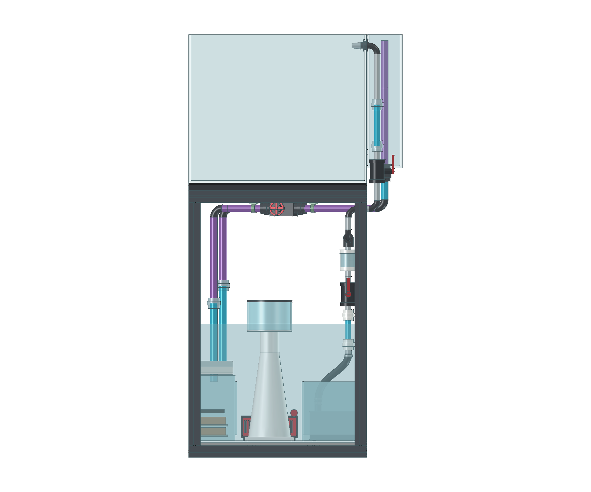
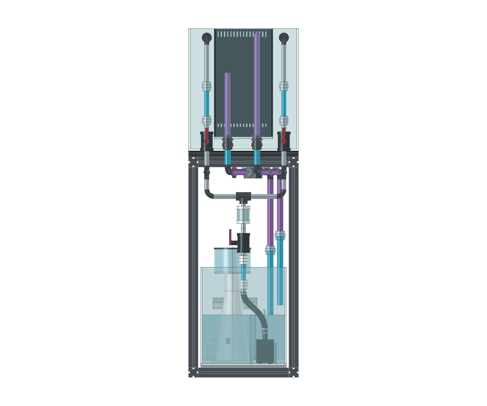
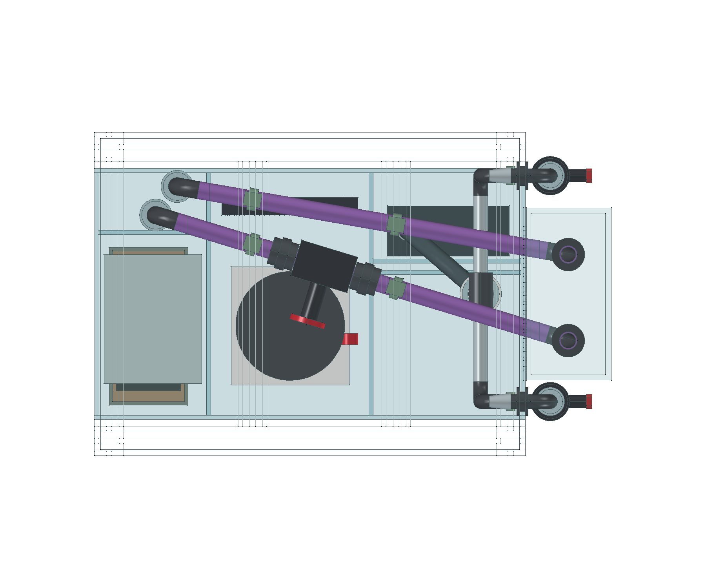
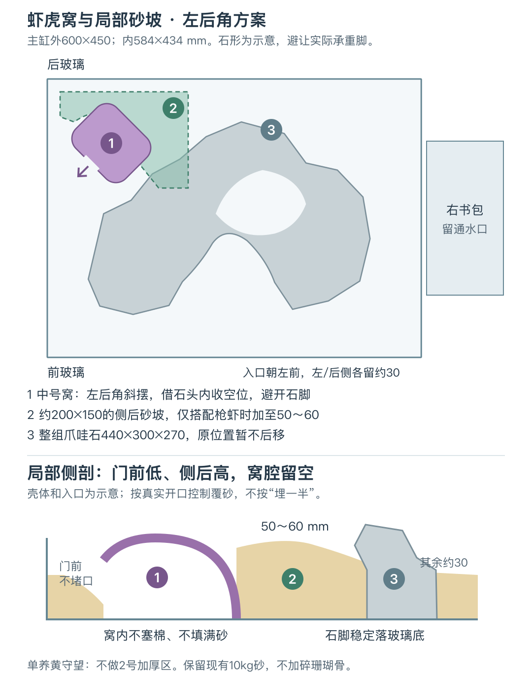

# 60cm DIY底滤海缸

上海客厅里的一缸60cm海水缸：铝型材架，上面主缸、下面底滤，管路自己设计、自己接。这里记下配置、做法和每天的养缸过程，给想自己搭底滤缸的人参考。

2026-11-12注水开缸，11-20起放清洁队，11-21首批公子小丑一对开始检疫。最新进度看[待办](01-待办.md)和[日记](06-日记/)。

## 配置

| 部分 | 配置 |
|---|---|
| 主缸 | 60×45×50cm，8mm玻璃；右侧长背包（沿侧面长24cm、外突12cm），上下鱼梳 |
| 底缸 | 60×35×40cm，6mm玻璃，五区成品缸 |
| 架子 | 4040铝型材成品架，60×45×90cm，正面无中柱，带4个轮子 |
| 水量 | 系统约170L（主缸、背包、底缸和管路合计） |
| 下水 | 两根25管，一主一备；应急管不装阀，单独落进底缸 |
| 上水 | 创宁CN-S600 18W，柜内主管到柜顶分两路20管回水嘴；全套5个阀：主管检修阀、两支路球阀、主排微调阀、上水止回阀 |
| 蛋分 | 迈光SK2200 |
| 灯 | 迈光MJ-L290臻蓝版，灯底离水面约20cm；光照程序见[L290设置](资料/设备设置/珊瑚灯L290光照设置.md) |
| 造浪 | 迈光MJ-GF308，装在后玻璃高处 |
| 加热 | 老渔匠圣盾二代低水位300W，独立温控插座只控加热棒 |
| 过滤 | 羊绒棉＋黑粗棉，棉下铺细菌屋；4块培菌砖垫在蛋分下；活性炭；藻格养钢丝藻，13W藻灯和主灯反着开 |
| 造景 | 整组爪哇石，44×30×27cm；AB巴厘砂10kg，平均约3cm；左后角放虾虎窝，周围堆5～6cm砂坡给黄守望和枪虾挖洞 |
| 水 | 家用RO净水器出水；蒸发每天约4L，人工补RO，自动补水器已买、暂未装 |
| 安全 | 两点水浸报警、主缸防跳围挡、插排固定在柜侧洞洞板上并留滴水弯 |
| 检测 | 益尔NH3/NO2/pH、沙里发NO3/KH、PO4试剂、海化铜测试，另有一台二手比色计 |

## 水怎么走

主缸 → 背包 → 主下水 → 底缸左后接水格 → 左前干湿格（羊绒棉 → 黑粗棉 → 棉下细菌屋）→ 中间蛋分格（蛋分、加热棒、培菌砖）→ 右前藻格（钢丝藻）→ 右后回水格（主泵）→ 两个回水嘴回主缸。

应急下水平时不过水，主排堵了才走，也落在左后格。滤棉堵了，水有路越过棉托直接回中间格。

| 右视 | 底缸俯视 | 虾虎窝与砂坡 |
|---|---|---|
|  |  |  |

图里少数位置还是旧占位（比如培菌砖），以[05方案](05-缸体与设备方案.md)为准。管路可以在[网页3D逐步装配](https://dystudio.fun/fish/assembly.html)里一段一段看，也可以下载后双击[离线版](资料/交付/管路3D装配.html)。

## 怎么做的

1. **设计**：主缸、底缸、架子、开孔和管路放在一起定，用FreeCAD建模，出三视图和3D装配页。
2. **架子和承托**：框梁共面，上面整块硬板，再铺整张缸垫，最后放缸；软垫不跨空，不只垫四角。
3. **管路**：管夹直接固定在型材槽上；整套先不上胶试拼，再分段粘接，等胶干透。
4. **试水**：用自来水试漏，同时试停泵回流、应急下水、堵棉旁通和止回阀失效；试完全部排掉。
5. **造景、注水**：空缸摆石铺砂，加RO并按桶计量，在底缸化盐到比重1.025、约26℃。
6. **无鱼养水**：硝化细菌加1%氯化铵水作氨源，每天测NH3和NO2；NH3不显色、NO2≤0.1就放第一批动物。
7. **清洁队先进**：螺、海胆、清洁虾和钢丝藻直接进主缸，不检疫。
8. **鱼全部检疫**：25L桶每轮1～2条，Cupramine铜0.5mg/L连续14天（蓝吊30天），期间吡喹酮两次，相隔7天；合格后只把鱼网进主缸，不带桶水。
9. **之后**：放鱼后每周换20L；鱼分批进；珊瑚等温盐、KH和氮磷连续稳定两周后再上。

每一步的操作和数值见[03安装与开缸](03-安装与开缸.md)，检疫和用药见[04生物与喂食](04-生物与喂食.md#检疫路线)。

## 生物

- **清洁队**：织纹螺、紫底星螺、金环宝螺、蓝礼服海胆、医生虾、火焰虾，一只红纹枪虾等着配黄守望。
- **鱼（计划约10条，6轮检疫）**：公子小丑一对（首批）、黄守望＋雷达、柠檬蟋蟀＋蓝鬼王、火箭吊、蓝吊、小型神仙1条、黄尾蓝魔。两条吊按过渡养，长大转出。鱼单还在调整，以[05生物配置](05-缸体与设备方案.md#生物配置)为准。
- **喂食**：每天早晚两次。
- **珊瑚**：先软体（菇、纽扣、皮革），再考虑好养的LPS；不养SPS。

## 文件

| 位置 | 内容 |
|---|---|
| [01-待办](01-待办.md) | 现在在做的事和下一步 |
| [02-采购清单](02-采购清单.md) | 按用途列出买了什么、接下来配什么，不含价格 |
| [03-安装与开缸](03-安装与开缸.md) | 从摆缸、试拼管路到开缸养水，按步骤写 |
| [04-生物与喂食](04-生物与喂食.md) | 检疫、入缸顺序、喂食、异常处理 |
| [05-缸体与设备方案](05-缸体与设备方案.md) | 缸、底缸、管路、架子和设备的规格和取舍 |
| [06-日记](06-日记/) | 每天的情况、读数和决定，按月一个文件 |
| [图纸与模型](图纸与模型/) | 三视图PNG、FreeCAD和STEP模型 |
| [海水养殖知识库](海水养殖知识库/) | 按12个主题整理的资料：建缸、管路、开缸、水质、过滤、鱼、珊瑚、清洁队、饲料、检疫、藻害、繁殖 |
| [决策记录](.维护/决策记录.md) | 改过的决定、为什么改 |
| [建模源文件](.维护/建模/) | 生成图纸和模型的FreeCAD脚本 |

选鱼和养护的网页版在[dystudio.fun/fish](https://dystudio.fun/fish/)。

## 阅读说明

- 文档里尺寸默认mm，顺序是长×深×高。
- “用户确认”是缸主自己定的；“助手建议”是AI助手给的建议，没有实测过；商家参数照商家说法记。
- 商家图片、别人拍的鱼图、抓取的数据和带价格的采购账本没放进仓库，文档里指向它们的链接在GitHub上打不开。
- 铝架承重、玻璃厚度这类结构问题，以你自己的实物和商家确认为准。
