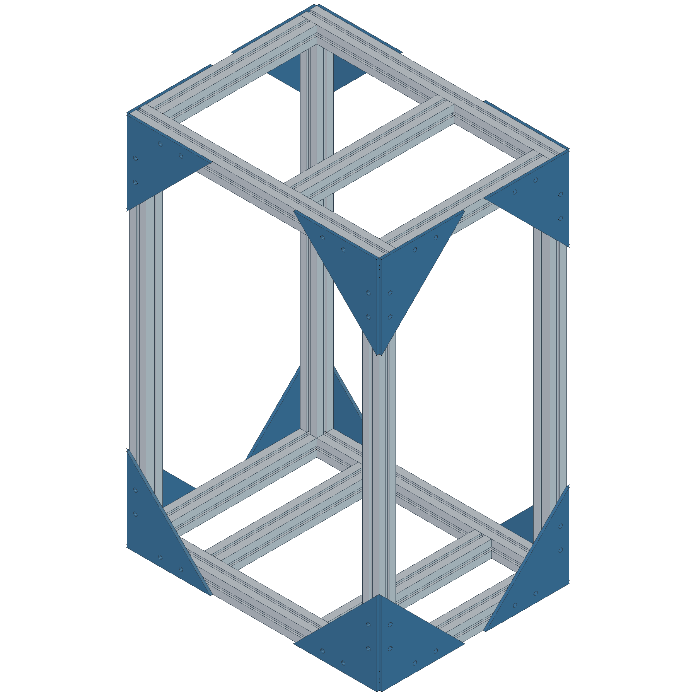

# Fishplan

上海客厅DIY底滤海缸：参数化设计、图纸、物料与搭建记录。

**当前进度：600×450×900、4040店家整架已下单，中间两根横梁、含底板451.90元；4个YS-60T福马轮另购68.67元，合计520.57元。店家表示承重400公斤，按商家陈述记录。见[采购记录](docs/采购记录.md)。下一步推进主缸、底缸与水路。**

**2026-10-19：FreeCAD v0.5原生模型和9页图册保留作空间参考，架子采用已下单的店家方案。旧逐件材料表停止用于采购，实际梁位、板/轮高度以后按店家图或实物更新。主缸按45/50高比较，采用内部溢流；底缸、盒位置及孔位仍为候选。**

## 现在先看

已读[店家支架采购图](docs/铝合金支架采购图.pdf)及[阅读记录](docs/支架采购图阅读记录.md)：裸架高900，上下框内各两根横梁，用户补充可移动；下层10mm PP板，上层支撑与主缸一起确定。当前讨论[45/50高主缸与内置溢流](docs/主缸选购与询价.md)。

先看[当前推进计划](DIY底滤海缸-项目推进计划.md)和[采购记录](docs/采购记录.md)。以下模型、材料数量及固定底座叠层为原设计参考，不当作店家实物数据。

1. [9页设计审阅图册](output/pdf/Fishplan-v0.5-设计审阅图册.pdf)：总装、裸架、正侧视、上下框、爆炸示意、节点、板材、设备及材料表。
2. [FreeCAD设计包与修改说明](design/freecad-v0.5/README.md)、[原生模型](design/freecad-v0.5/Fishplan-v0.5.FCStd)。
3. [同版联合布局与容水](design/联合布局与容水-v0.5.md)、[材料清单](design/freecad-v0.5/材料清单-v0.5.md)。
4. [系统审阅顺序](docs/方案审阅入口.md)、[需求](docs/需求清单.md)、[交接](HANDOFF.md)。

15根型材：600×4、370×7、820×4，净长8.27m。含外节点外包612×462；盘/地面承压板630×480。现场该方向约700，未来外挂可超600，具体操作余量待布局。台面离地940，400高主缸顶约1343，调平另计。底缸420×310×460候选，头部337。

模型已实际改深度/架高验证联动并恢复；原生文件重新打开后改参通过，STEP已重新导入核对。型材槽仅示意，真实节点/玻璃/穿缸接头、完整设备装取、实测容水和全配报价尚待核验，见[模型验证记录](docs/模型验证记录-v0.5.md)。

## 参考与后续

[网上参考图索引](example/README.md)、[设计文件格式约定](docs/参考方案评阅与交付格式.md)。主模型继续深化面板、灯架、节点及管路；Markdown保存需求和决定，图册用于审阅，STEP/DXF按同版导出供商家核对。

砂、活石、首批造浪、独立应急下水和手动换水沿用。防漏/噪声保护、冷水机位置、防猫盖仍按专项推进，本版固定底座无轮。没有有效全配报价，不把历史估算当现价。

## 同步与复现

已有副本保存本地修改后运行 `git pull --ff-only`；首次克隆 `https://github.com/Dynamite1847/Fishplan.git`。认证不随项目同步，不提交凭据。

原生模型打开即可继续改参数；重建脚本及图册导出方式见[设计包说明](design/freecad-v0.5/README.md)。重跑脚本会采用其默认参数，先另存手动修改。

[旧v0.4架体包](design/frame-v0.4/README.md)、[旧v0.4审查](总体可落地性审查-v0.4.md)及v0.2/v0.3文件保留追溯；旧580×430内缩框与旧下料停用。旧询价文本待更新至新尺寸及真实供方件，暂不直接发送。原背滤采购记录位于[archive](archive/README.md)。
