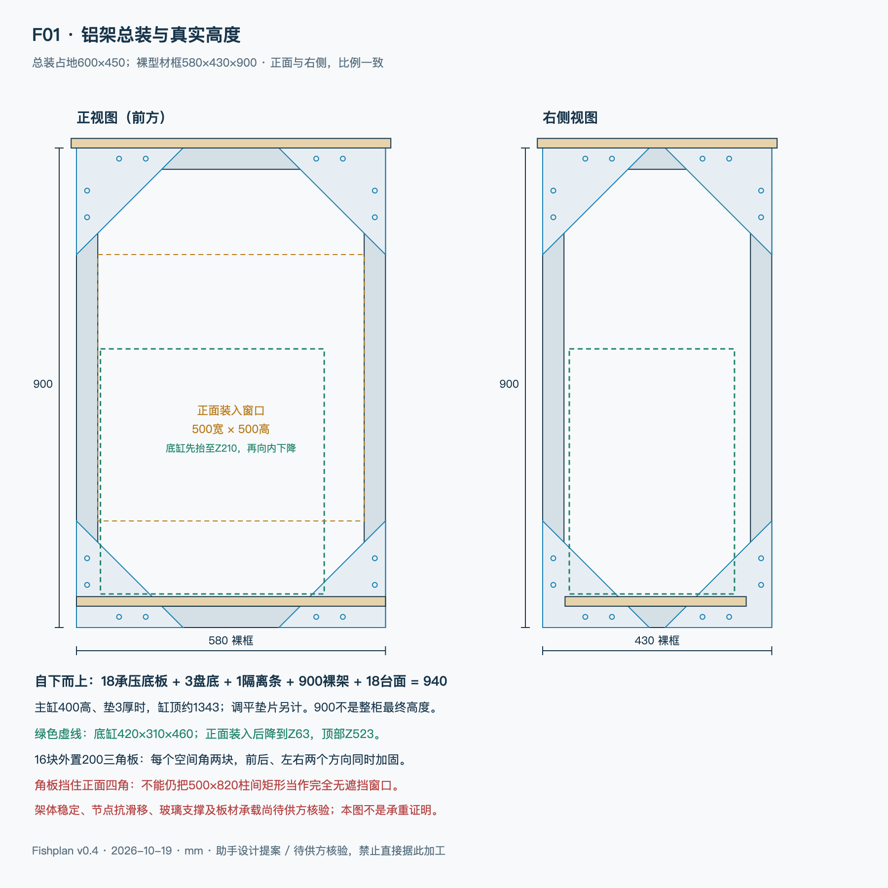

# Fishplan

上海客厅DIY底滤海缸：需求、设计、询价与搭建记录。

**2026-10-19：完成总体审查及v0.4铝架详细提案。用户已接受约900高、维护优先；当前可统一询价和复核，尚未冻结加工或完成实测。**

## 当前入口

1. [总体可落地性审查](总体可落地性审查-v0.4.md)：旧版问题、修订和剩余证据关口。
2. [铝架详细设计图册](design/frame-v0.4/README.md)：4张PNG/SVG尺寸图、2份mm二维DXF。
3. [完整材料清单](design/frame-v0.4/材料清单.md)：下料、节点、五金、板材、底座和盘，不漏备用/运输。
4. [节点与全部坐标](design/frame-v0.4/构型与节点.md)、[装配验收](design/frame-v0.4/装配与验收.md)、[现成询价文本](design/frame-v0.4/型材商询价文本.md)。
5. [同版底缸、水路与容水](design/联合布局与容水-v0.4.md)。
6. [交接](HANDOFF.md)、[需求](docs/需求清单.md)、[推进计划](DIY底滤海缸-项目推进计划.md)。



总装600×450；裸型材框580×430×900，四边内缩给外置节点/盘壁，台面与主缸平面对应；加底座/台面后离地约940。15根4040净长8.05m，16外节点板、12内梁角码。候选底缸420×310×460，头部净高337。**尺寸为助手同版提案，450深、结构/玻璃/孔位、预算仍待联合确认；4040不自动等于承载合格。**

砂、活石与首批造浪，主下水+独立应急、手动换水方向保留。猫盖后做但留接口，冷水机外置位置/散热未定，固定底座不含轮。预算需拿本版全配报价，旧规划区间不是实时淘宝价。图为本项目原创示意，非品牌加工图。

## 接着工作

已有副本先保存本地修改，再运行：

```sh
git pull --ff-only
```

首次使用：

```sh
git clone https://github.com/Dynamite1847/Fishplan.git
cd Fishplan
```

认证不随仓库同步，不提交凭据或验证码。复现图纸与计算：`python3 scripts/generate_v04.py`，生成SVG/JSON/DXF后渲染PNG；见[验证记录](docs/文档验证记录-v0.4.md)。

[旧v0.2总览](方案总览-v0.2.md)、[v0.3补充](继续推进-v0.3.md)和[旧图目录](design/图纸目录-v0.2.md)仅作设计追溯，不与本版尺寸拼用。原背滤清单在[archive](archive/README.md)，不作当前下单依据。
