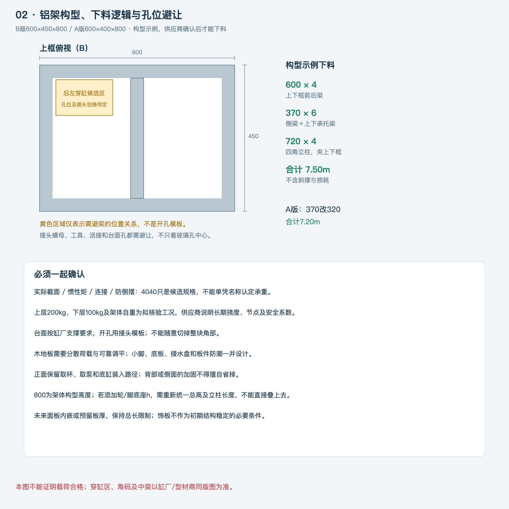
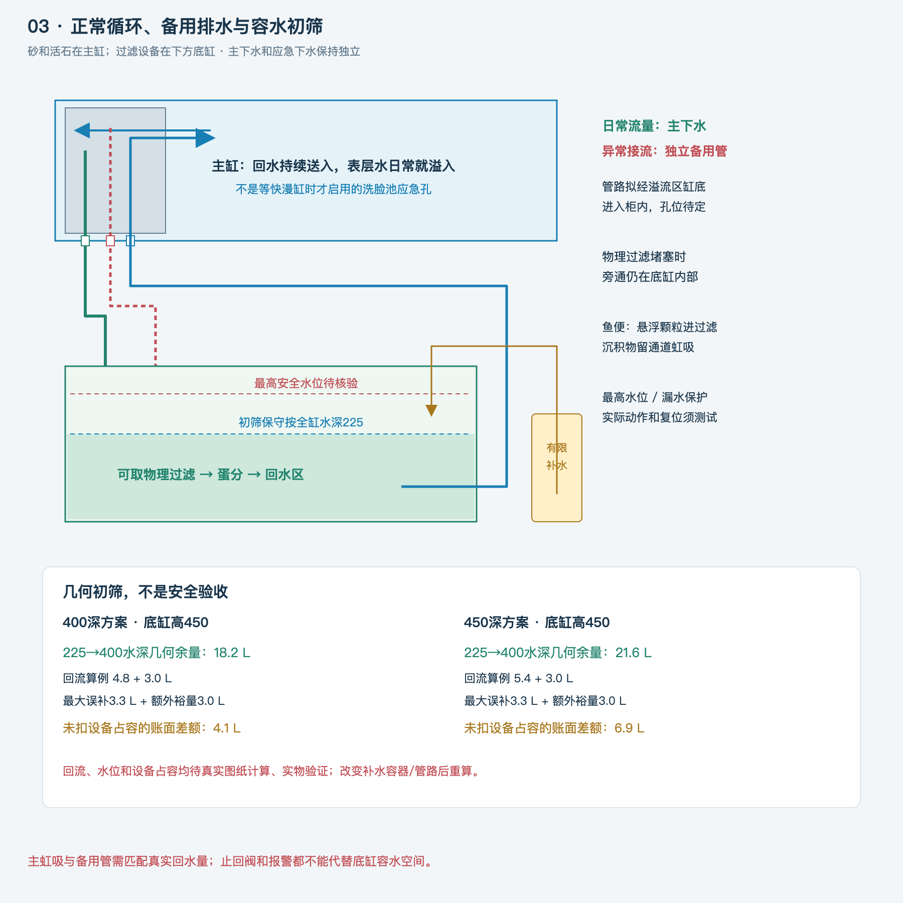
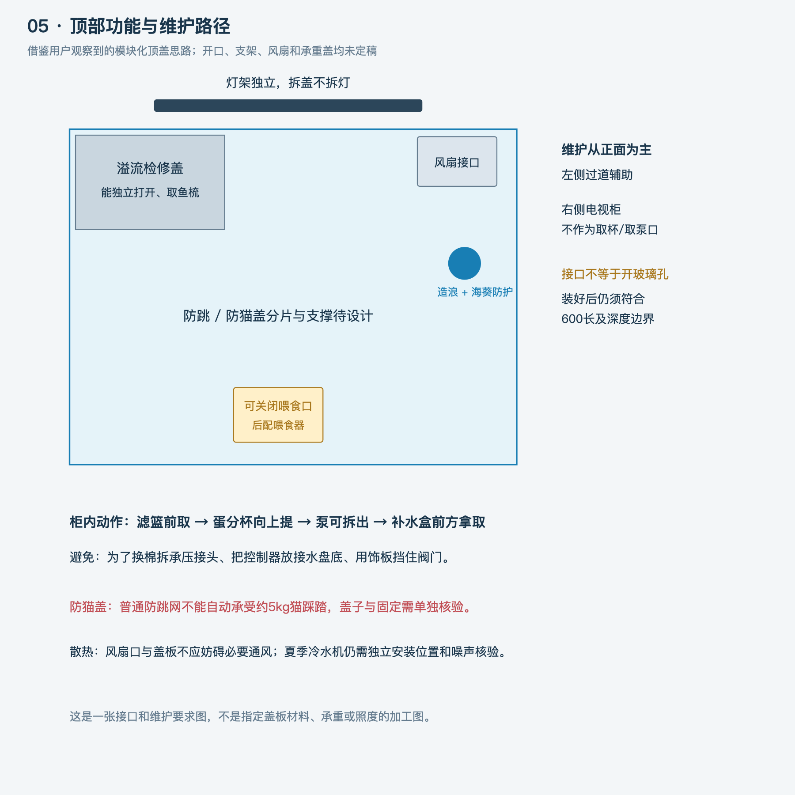

# 图纸目录 v0.2

更新：2026-10-19。所有图片为本项目原创方案示意，不是品牌照片，也不是已确认的加工图。SVG可放大查看，PNG便于预览和传阅。

## 01 三视图与柜内布局

[SVG原图](01-三视图与布局-v0.2.svg) · [PNG预览](01-三视图与布局-v0.2.png)

## 02 铝架、下料逻辑和孔位避梁

[SVG原图](02-铝架与避梁-v0.2.svg) · [PNG预览](02-铝架与避梁-v0.2.png)

## 03 水路与容水算例

[SVG原图](03-水路与余量-v0.2.svg) · [PNG预览](03-水路与余量-v0.2.png)

## 04 开放架与后装面板的外观方向

[SVG原图](04-外观与面板示意-v0.2.svg) · [PNG预览](04-外观与面板示意-v0.2.png)

## 05 顶部功能与维护路径

[SVG原图](05-顶部与维护-v0.2.svg) · [PNG预览](05-顶部与维护-v0.2.png)

## 06 固定底座与可收回轮

[SVG原图](06-底座与轮子-v0.2.svg) · [PNG预览](06-底座与轮子-v0.2.png)

## 图纸对应的文件

- [方案总览](../方案总览-v0.2.md)
- [铝架与台面说明](铝架与台面-v0.2.md)
- [主缸与管路说明](主缸与管路-v0.2.md)
- [底缸与维护说明](底缸与维护-v0.2.md)
- [铺砂、活石与造浪](活石铺砂与造浪-v0.2.md)
- [底座与轮子说明](底座与可收回轮-v0.2.md)
- [几何与物料算例](几何与物料算例-v0.2.json)

图中的“约”“候选”“待核”均保留其含义；玻璃厚度、孔位、接头、设备、载荷和安全余量需在统一加工图中落实。
