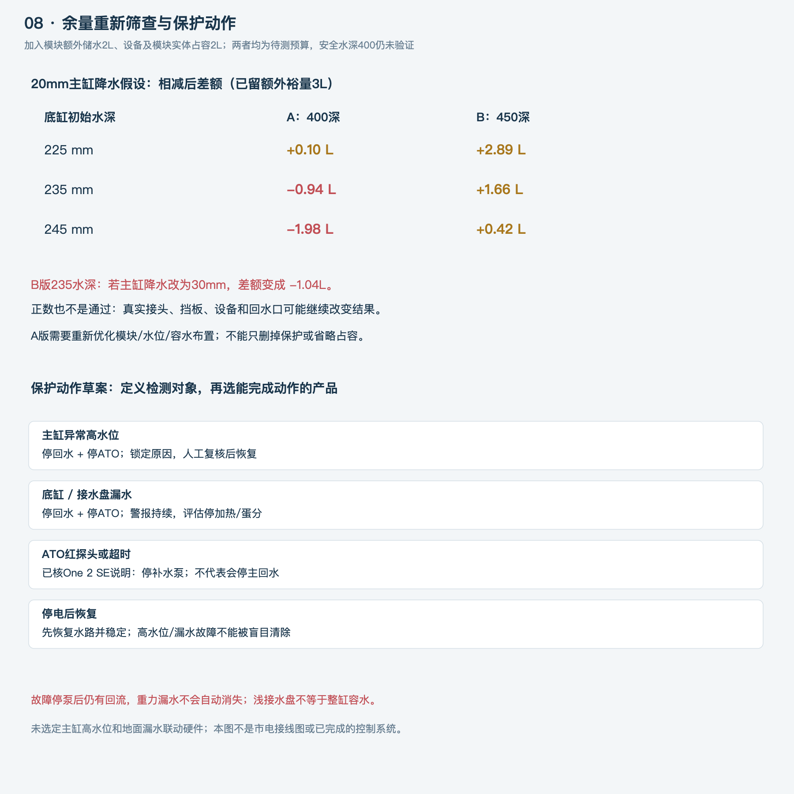

# 容水复核 v0.3

v0.2只比较几何上界，并明确未扣设备等影响。本轮加入额外储水、实体占容及工作水位变化，属于敏感性复核；没有实际测量或安全验收。

## 算例条件

- A内平面388×268，B388×318；最高安全水深400仍是假设。
- 全部底缸仓按225/235/245保守比较。未来回水仓更低可增加余量，当前不先占用该好处。
- 主缸停泵降水比较10/20/30，按600×400或600×450外平面上界计算。
- 溢流区/管路附加回流3L，限量ATO3.3L，额外裕量3L。
- 模块高位液体额外储水预算2L；设备及模块实体在涨水区占容预算2L。二者是独立的待测输入，不能当测得值或安全系数。

`差额 = 底缸几何余量－主缸回流－3－3.3－3－2－2`

## 18组结果

表中数字已扣额外裕量3L，均未证明参数真实或通过验收。负数表示该组预算不够；正数只说明该组预算尚有账面差额。

| 主缸深 | 底缸初始水深 | 降10差额/L | 降20差额/L | 降30差额/L |
|---|---:|---:|---:|---:|
| 400 | 225 | +2.50 | +0.10 | -2.30 |
| 400 | 235 | +1.46 | -0.94 | -3.34 |
| 400 | 245 | +0.42 | -1.98 | -4.38 |
| 450 | 225 | +5.59 | +2.89 | +0.19 |
| 450 | 235 | +4.36 | +1.66 | -1.04 |
| 450 | 245 | +3.12 | +0.42 | -2.28 |

## 如何理解

B235/降20约余1.66L，A同工况约-0.94L；B若降30也变约-1.04L。不是证明450深必安全，也不是证明400深永远不能做，而是当前设备/模块/水位组合不能沿用v0.2较大的空几何差额。

下一步先测或取得图纸关闭：主缸运行和停泵水位、主/备立管停泵排空、回水喷嘴最低可停位置、模块真实存水、设备涨水段占容、最后仓运行水位及ATO最大物理容积。管口越深或未来加冷却管路，不能沿用旧算例。

可研究的优化包括减少模块高位存水、不同分仓/工作水深、真实可取出的更合适设备、回水口位置和底缸/架高组合。回水仓降低水位可能多出容水空间，但同时缩小蒸发缓冲，必须核对最低浸没和缺水保护。不能缩小独立应急下水、删实体占容或仅靠止回阀使数字转正。

测量时用同等水位的加水差量或几何上界，记录设备、阀位和管路版本；设备改变后复测。全系统组合故障试验见[验收清单](../验收与维护-v0.2.md)，不要直接在木地板上制造不可控满溢。

[JSON输入与结果](余量敏感性-v0.3.json)由[脚本](../scripts/generate_v03.py)生成，v0.2几何模型保留作对照。本版只更新复核依据，没有冻结235水深、400最高安全线或模块尺寸。
