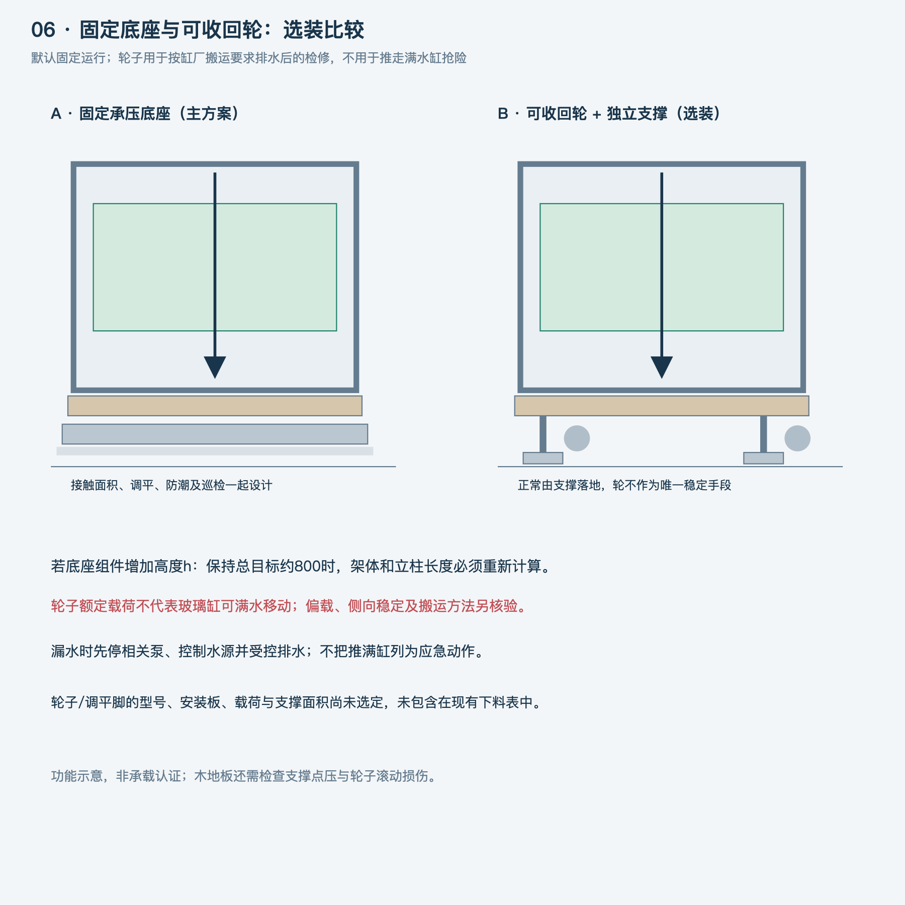

> **最新决定：用户已另购4个YS-60T福马轮，配店家600×450×900整架；当前以[采购记录](../docs/采购记录.md)为准。下文固定底座、800标高和未选轮状态保留历史用途，实际安装高度和支撑方式以后按订单资料/实物更新。**

# 底座与可收回轮 v0.2

用户询问能否加轮子，遇到情况快速移动鱼缸。此项记录为可选需求，未选购脚轮。

## 当前建议

主方案仍为稳固、可调平且分散木地板荷载的固定底座。另保留可收回轮＋独立落地支撑方案，用于按缸厂搬运要求排水后的检修移动。

不把“发生漏水时推走满缸”列为应急方法。轮子额定载荷不能证明玻璃缸可以承受移动中的侧向受力、晃水和地面不平；停相关泵、控制水源及受控排水属于另一套应急流程。

## 选装方案的核验条件

- 正常运行时，稳定支撑落地承重，不能只凭轮子的刹车保持整架稳定。
- 厂家给出轮子、支撑脚、安装板、型材节点、偏载、侧向稳定和承重方案，不只相加四只轮子的额定公斤数。
- 木地板核对支撑面、点压和滚动损伤。收回轮不意味着支撑脚的小底垫就适合木地板。
- 取底缸、接水盘和面板时不被轮/脚组件挡住；管路和电线不能在移动时拉扯主缸。
- 总高度统一：若底座组件有效高度为h，希望保持约800的底部总高度，则原构型的架体和立柱需减去对应高度并重新核验。不能直接在800高架子下叠轮子。
- 移动前的减水、活石/设备处理、断电及管线安排由缸厂给出搬运流程，不在本稿随意规定“抽掉几成水就安全”。

当前没有取得脚轮厂家或缸厂的满水移动适用证明，也没有选定具体轮子型号。轮子与安装费用不包含在现有固定架预算及7.5m型材示例中。

如后续坚持移动能力，先把轮/脚组件作为独立结构方案核验，再回填架高、下料和预算。
