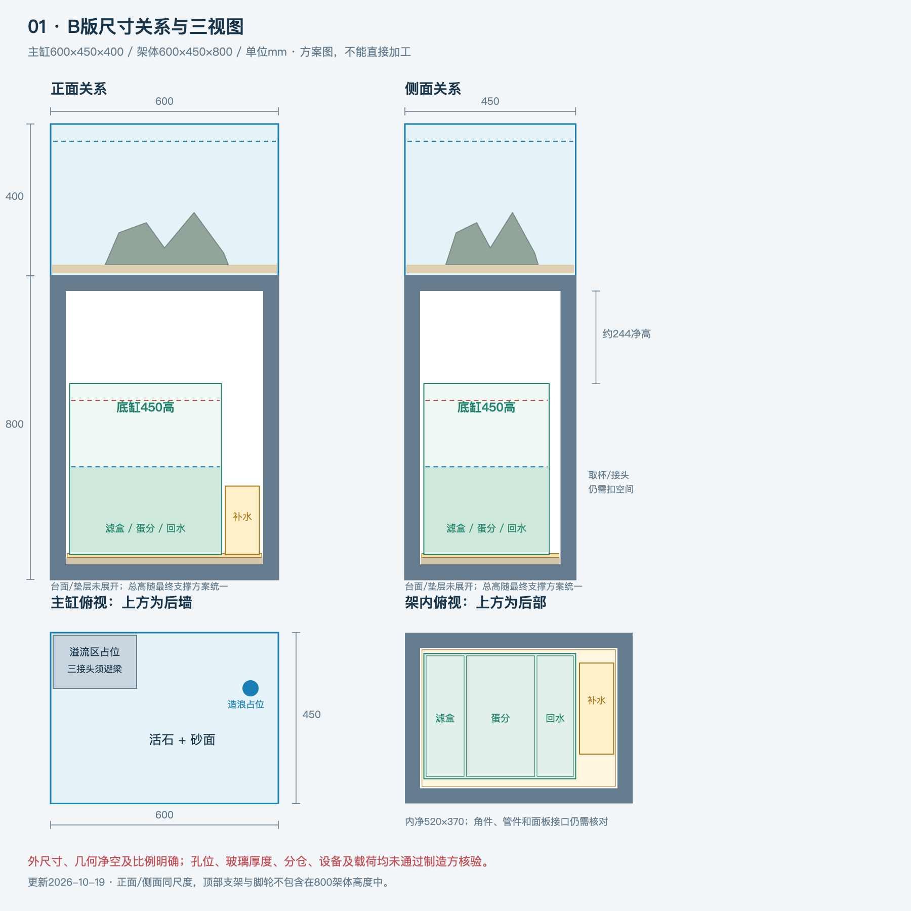

> **版本提示：本文件为历史方案。当前以[总体审查v0.4](../总体可落地性审查-v0.4.md)、[铝架详细包](../design/frame-v0.4/README.md)及[联合布局/容水](../design/联合布局与容水-v0.4.md)为准。原图尺寸、下料和水位不可与v0.4混用，不是加工单。**

# 底缸、设备空间和维护 v0.2

状态：明确到功能区与空间准入条件的设计草案。实物设备、过滤模块和工作水位未验证。

> 后续：[滤篮模块v0.3](滤篮模块与维护-v0.3.md)已细化水路，[容水复核v0.3](容水复核-v0.3.md)已增加高位存水和设备占容，[设备空间v0.3](../research/设备空间与回水核验-v0.3.md)发现整机取出净高瓶颈。本页作为基础几何保留，不将其容量差额当最终值。

## 候选外形与高度变化

- B版：底缸400×330×450。
- A版：底缸400×280×450。
- 相比v0.1的400高，本版提高到450，目的是在运行水位可能超过200时仍有更多停泵容水空间。清洁及取杯净高同步核对，不能只看容积增加。
- 6厚玻璃仅用于几何算例。缸厂若采用不同厚度，全部内尺寸重算。

架内几何净空按4040构型示例为520×370或520×320。底缸之外需容纳接水盘、管件、固定件、后装面板接口和低矮补水盒，未确认成品兼容。

## 功能分区及设备准入

按400外长、两侧各6厚、两块6厚分隔估算，内部长度388。先用以下净长度检验空间：

| 区域 | 净长度示例 | 主要用途 | 维护要求 |
|---|---:|---|---|
| 左：接水与物理过滤 | 100 | 后部接主下水，前部取滤篮；正常低落差流动 | 滤篮从正面或上方直接拿出，不要求拆承压接头换棉 |
| 中：蛋分/设备 | 180 | 蛋分、必要的少量可取滤材 | 基座候选尽量在150×160以内，取杯直径、挂架和出水也需计入 |
| 右：回水 | 96 | 回水泵、补水传感器，视说明布置加热设备 | 泵在96这个方向的实际外形宜不大于约75～80，另核管接头和取出路径 |
| 两处分隔 | 6＋6 | 形成需要的工作水位和流路 | 挡板高度、是否防气泡需按实物确认，不按表直接粘 |

B版内深估算318，A版268。上述设备空间是候选准入条件，不意味着所有“适用100L”的设备都放得下。

## 谷特思路的海缸化取舍

接水区可采用较低落差的翻水/接水结构，物理滤篮靠前，借鉴可拆盒的便利。具体盒体内部水道尚未设计完成，需同时核验以下行为：

- 正常水流尽量不产生瀑布落差和大量吸气。
- 滤棉堵塞时，水能在底缸内部越过旁通进入后续区域，不漫出缸外。
- 应急下水不把滤棉是否干净作为排水前提。
- 滤篮能直接取出，下面可看到并吸走沉积。
- 第一版不强制三种棉逐层串联；先采用海水适用、无不明添加的可更换过滤材料及支撑篮。

本版不设独立藻仓，不设两个大型滤材仓。蛋分、回水、余量与维护通道优先；需要少量额外滤材时用可取滤篮，后续再按实测水质评估藻类方案。

## 工作水位与容水

初步目标：蛋分所在区域可在设备允许范围内设定，优先核验约180～225水深适用的设备；回水区随蒸发有变化，由补水稳定。**不是声称候选蛋分都能在这个范围工作。**

容量初筛为保守起见，假设整个底缸初始水深均为225，不占用较低回水区提供的额外空间；暂定最高安全水深400，二者从内底面量起。

| 项目 | A：400×280×450 | B：400×330×450 |
|---|---:|---:|
| 假设内平面 | 388×268 | 388×318 |
| 225→400水深的几何余量 | 约18.2L | 约21.6L |
| 主缸假设降水位20，按外平面估算 | 4.8L | 5.4L |
| 溢流区、管路等附加回流的算例额度 | 3.0L | 3.0L |
| 补水盒最大实际水量算例 | 3.3L | 3.3L |
| 额外预留裕量算例 | 3.0L | 3.0L |
| 相减后、仍未扣设备及接头占容的账面差额 | 约4.1L | 约6.9L |

上述回流水位差、附加回流、最高安全水深及裕量都是待验证参数。设备、管件和真实水道会改变结果，不能直接宣布任一版通过安全验收。

如果真实工作水位高于225、附加回流超过3L或补水盒更大，必须重算。优先调整底缸和布置，不能删掉应急排水、监测或安全余量凑空间。

## 补水盒与防虹吸

图示侧边可留约90宽的小容器位置。可以向缸厂询问独立低矮盒的加工价，也可选真实尺寸匹配的现成容器；没有必要先买不明规格的窄桶。

几何示例：外形约90×240×180、壁厚按5计算，内尺寸80×230×175，满至上沿约3.22L。本算例按3.3L计故障输入上限；若实际容器更大或厚度改变，重新测量并计算。

最高加水线按日常使用留边，但故障容水不能只按加水线以上“用户不会加满”假设。容器最大物理容水量才是限量依据。上部留空的盒体不得用盖子密封并直接接RO压力水。

容器不靠重力向底缸持续供水；补水管固定出口并核对反虹吸。是否需要防虹吸件按所选补水设备安装说明确认。3L左右能用几天由实际蒸发量决定，不承诺固定续航。

## 维护净高

按架本体800、上下横梁各40、底板约18、接水盘底部占高暂8计算，底缸450高后，缸沿到上框内沿还有约244净高。这个值仅为几何示例，尚未扣具体接头和台面附件。

蛋分要核对实际总高、取杯提升距离、是否需要垫高；回水泵要能在不拆主缸的情况下取出。中间设备仓上方不布置阻挡取杯的永久储物架。

所有图示功能区需由实际设备和制造方做一次“装进去、拿出来、换棉、取杯、吸底”的维护演练核对。

## 设备核验修订

已查QQ2原厂说明，挂装沿到水面最大35mm，不能直接挂450高底缸外沿而用225水深。QQ2撤出默认适配候选；不为适配它抬高全底缸水位，优先找适用180～225工作水深、可落在中仓且能取杯的蛋分。见[说明核验](../research/设备说明核验记录-v0.2.md)。

补查TUNZE 9004.000有110×90×305及225～245浸没官方参数，列为下一步候选，未默认选购。若底部净空等要求使正常水深高于225，按实际高度重算容量，再定挡板；详见同一核验记录。
