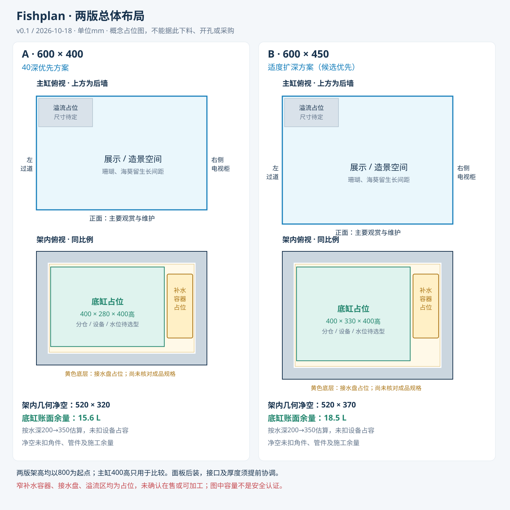
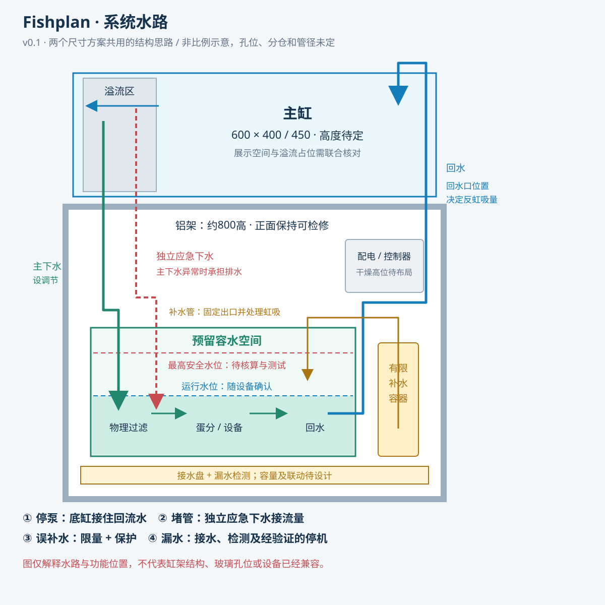

# 总体布局 v0.1

日期：2026-10-18。阶段：系统总体方案初稿。

**这份文件是助手提出的条件方案，不是用户已确认尺寸、加工图、承载结论或已验证的防漏方案。**

## 当前判断

建议优先核验600×450的匹配缸架方案，600×400保留为紧凑备选。理由是增加的50深度既有利于主缸造景，也能增加底缸前后空间及容水余量。

这个判断来自同一组几何假设的比较，并不表示400深不能做底滤，也不表示450深已经能装下所需设备或保证安全。若实际设备、接头和停泵水量不符合假设，应调整设计。

主缸高度暂用400比较，底架本体高度暂用800。均未冻结，后续协调台面、垫层、观看与维护高度。

## 1. 两版俯视布局

图片备份：[PNG预览](布局比较-v0.1.png)。两版平面采用相同比例。

| 比较项 | A：600×400 | B：600×450 |
|---|---:|---:|
| 主缸外尺寸比较起点 | 600×400×400 | 600×450×400 |
| 按外尺寸算的满缸体积 | 96 L | 108 L |
| 假定水深350、内长584时，扣除玻璃但未扣造景及溢流的水量 | 约78.5 L | 约88.7 L |
| 架子外形比较起点 | 600×400×800 | 600×450×800 |
| 前后及左右各占40型材时的平面净空 | 520×320 | 520×370 |
| 底缸占位尺寸 | 400×280×400 | 400×330×400 |
| 补水容器 | 架内侧边预留窄区，规格未选 | 架内侧边预留窄区，规格未选 |
| 清洁与拆洗 | 正面为主，左侧辅助 | 正面为主，左侧辅助 |

主缸8厚、底缸6厚均只是计算内尺寸用的几何假设，不是玻璃厚度建议。玻璃、粘接及支撑结构交制缸商确认。

架内净空未扣角件、面板连接件及管路。图中接水盘约510×310或510×360、补水容器平面约90×225，仅用于检验空间关系；尚无已验证的现成规格、容积、板厚或加工方案。若窄桶、接水盘或维护动作不合适，应改变底缸与容器布置，不能为了图面整齐强行采购。

先前450×350×350底缸未定稿，本稿也不沿用该尺寸。这里只提出两组新的比较占位，后续由设备尺寸决定底缸长宽和分仓。

## 2. 系统结构

图片备份：[PNG预览](系统水路-v0.1.png)。本图不按比例，管线交叉不表示相互接通。

- 主缸后左侧暂放溢流功能区，利用左侧可达的条件检修；溢流尺寸和孔位需跟接头、玻璃孔距及架梁一起设计，图示不能直接用于开孔。
- 主下水和应急下水保持独立。主下水调节日常流量，应急下水按设计最大实际回水量校核。
- 底缸先按物理过滤、蛋分或设备、回水三个功能区安排。暂不锁定分仓长度，不预置复杂滤材迷宫。
- 回水泵、补水传感器设在适当的回水区域，设备可以从正面拆出。回水口与补水管分别核对虹吸，不把小孔或止回阀当作唯一保护。
- 补水采用有限容量的独立容器，具体容量要跟可用余量和可接受添水频率一起选；示例的3 L、5 L不是最终采购规格或续航承诺。
- 接水盘、漏水检测和配电干燥位置一开始就占空间，不等设备塞满后再补。接水盘只作为有限的二次接水，不按整缸破裂容水设计。
- 当前图没有把冷水机塞进柜底。需要另找满足散热、管线和噪声条件的位置；不能自动把左侧过道当作可占用安装区。这个位置仍是后续设计依赖。
- 初期开放架，未来面板尽量内嵌或采用已经预留厚度的接口，保证整体长度要求；面板可拆，架子在无饰板时也需独立满足结构要求。

## 3. 容水余量的示例比较

这部分用来说明尺寸、运行水位和补水容量如何影响设计，不作为安全验证结果。

共同假设：底缸外高400，计算内平面按388×268或388×318；运行水深200，暂定最高安全水深350，均从内底面量起。各仓都能利用这段空间，暂未扣除设备和管路占容。实际工作水位须按所选设备确认。

计算：`内长 × 内深 × (最高安全水深－运行水深) ÷ 1,000,000`。

| 几何比较 | A：400深 | B：450深 |
|---|---:|---:|
| 底缸200→350水深之间的账面余量 | 15.6 L | 18.5 L |
| 主缸假设停泵降水位20，按外平面保守估算 | 4.8 L | 5.4 L |
| **假设**溢流区及管路另回流 | 2 L | 2 L |
| **假设**补水容器最多误补入 | 3 L | 3 L |
| **示例**额外预留裕量 | 3 L | 3 L |
| 上述示例相减后的账面差额，仍未扣设备占容 | 2.8 L | 5.1 L |
| 若补水最大误补量改为5 L，其余假设不变 | 0.8 L | 3.1 L |

因此，在这组假设下，450深多约2.9 L底缸几何余量；因为主缸同时变深、回流水也增加，3 L补水算例的净差额实际只增加约2.3 L。不能只看底缸变大就认定安全。

水位下降20、额外回流2 L和裕量3 L都是示例参数，尚未由真实水路确认。设备占容、分仓水位、回水口、补水管、管径、冷却回路改变时均需重算。现阶段两版都不能判定通过防溢验收。

计算参数及原始结果保存在[容量估算JSON](容量估算-v0.1.json)，由[生成脚本](../scripts/generate_layouts.py)统一产生。

## 4. 维护方式

- 旧水从主缸使用临时固定的虹吸管或小泵抽入桶，人工搬运，不增加永久排到水池的管路。
- 滤棉或其他物理过滤件靠近正面、容易取出；蛋分集污杯、回水泵和传感器有直接拆洗路径。
- 补水容器从正面添水或取出，管口固定。若窄区使操作过于费事，重新安排容器，不为了隐藏而牺牲易维护目标。
- 换水时暂停补水，设备按水位需要启停；恢复循环、核对运行水位后再开启补水。
- 初期开放架不能承诺隔音，蛋分进气、泵振动和未来冷水机均需选择及实测。后装洞洞板也不等于隔音板。

## 5. 进入下一阶段前的重点

1. 以B版为优先候选、A版为备选，核验蛋分、回水泵、补水容器及接水盘的真实尺寸和拆洗空间；不是要求用户现在拍板450深。
2. 设备核验后再决定底缸尺寸、分仓及工作水位。必要时同步调整占位尺寸或架高，不优先压缩容水安全余量。
3. 找到未来冷水机可能的安装位置，并确认右侧电视柜及墙边的必要安装间隙。
4. 明确溢流结构、回水口和管路，再计算真实停泵水量、应急排水能力及补水上限。
5. 确认台面、型材连接及支撑结构，再绘制有孔位和下料尺寸的加工图并询价。

参照[项目推进计划](../DIY底滤海缸-项目推进计划.md)，现已开始第2阶段；本稿的设备空间尚未验证，不能越过后续设备选型、联合布局和详细设计。

防漏原则及参考来源见[防漏与防溢设计要求](../docs/防漏与防溢设计要求.md)。本稿没有新增商家报价或已确认的商品兼容性。
