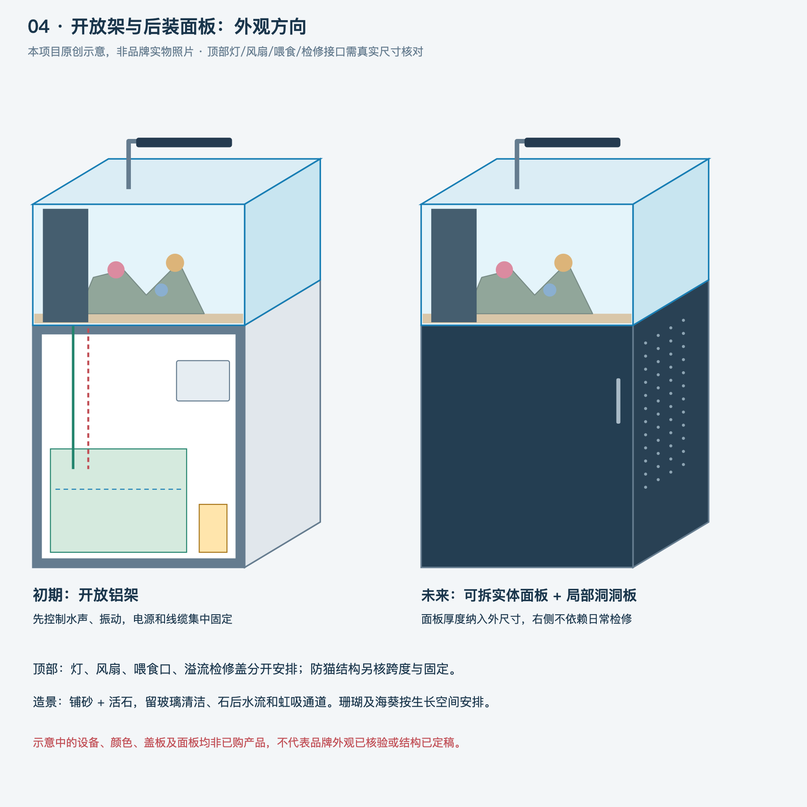

> **版本提示：本文件为历史方案。当前以[总体审查v0.4](总体可落地性审查-v0.4.md)、[铝架详细包](design/frame-v0.4/README.md)及[联合布局/容水](design/联合布局与容水-v0.4.md)为准。原图尺寸、下料和水位不可与v0.4混用，不是加工单。**

# Fishplan方案总览 v0.2

日期：2026-10-19。用途：设计评审、商家出图及询价准备。**不是可直接加工的定稿，也不是已经验证安全的整套商品。**

[先看六张图纸和外观示意](design/图纸目录-v0.2.md)。

> 后续已补[v0.3设备与维护复核](继续推进-v0.3.md)。本版225水深与未扣设备的差额保留作对照，当前还需纳入模块存水、占容及完整取出路径；优先读补充再询价。

## 当前推荐

主方案按 **600×450×400主缸＋匹配长深、约800高铝架** 继续核验，600×400为紧凑备选。长深为用户边界内的助手建议，未替用户锁定最终尺寸。

采用柜内底滤：主缸内部后左溢流区 → 主下水及独立应急下水穿缸底 → 柜内底缸 → 回水泵经独立回水管穿回主缸。正常循环与溢流直接有关，不是等快漫缸才开始排水。

主缸铺砂和活石，造浪列首批设备。固定底座为主，可收回轮为独立检修选项，不能把推满水缸作为应急。

低维护、噪声和防漏共同影响布局。接水盘、报警和容水余量在第一版就占位置。上水止回阀只可作辅助，不能替代停泵余量。

## 这版相比v0.1的推进

- 明确正常溢流与应急排水的区别，补上鱼便及沉积物的实际清洁路径。
- 吸收用户观察到的谷特顶部接口、可取滤篮和静音水路思路，针对海缸保留蛋分空间，藻仓后置。
- 明确框架结构示例、完整下料逻辑、孔位避梁区域和供应商需核验的载荷。
- 底缸候选由400高调整到450高，先按较高的225运行水深保守计算，再检查维护净高，避免沿用v0.1较乐观的统一200水深。
- 物理过滤、蛋分与回水形成具体空间准入条件；补水盒明确为需要核验或定做的小容器，不假装已有适配商品。
- 准备设备候选、预算分项、商家询价文本、验收与交接清单。

## 结构表

| 项目 | B：主方案候选 | A：紧凑备选 | 状态 |
|---|---|---|---|
| 主缸 | 600×450×400 | 600×400×400 | 400高为助手建议，未冻结 |
| 架体 | 600×450×800 | 600×400×800 | 台面、垫层是否计入总高需出图统一 |
| 底缸 | 400×330×450 | 400×280×450 | 厚度、分仓、设备兼容需缸厂和设备确认 |
| 物理过滤 | 后侧接水、前侧可取过滤篮，堵塞时在底缸内旁通 | 同功能，前后空间更紧 | 功能确定，盒体图待加工方核对 |
| 蛋分 | 底缸中间功能区，优先小型内置或可在缸内安装的型号 | 同上 | 型号与工作水位尚未锁定 |
| 回水 | 右侧回水区，补水传感器随实际水位安装 | 同上 | 泵尺寸、接口及扬程待说明书核对 |
| 补水 | 独立低矮小容器，实际最大容水约3.3L的算例 | 同上 | 不是已购产品，需确认真实容积与防虹吸 |
| 藻仓 | 本次不独立分仓，可后续重新评估 | 同上 | 不把未来选项挤进当前底缸 |
| 接水与监测 | 底层接水盘、漏水检测、独立高水位保护方向 | 同上 | 容量与实际联动需选型和试验 |
| 顶部 | 灯架、风扇、喂食口与可关闭盖板的接口预留 | 同上 | 猫盖承重与材料另核验 |

## 设计文件

1. [主缸、溢流和管路](design/主缸与管路-v0.2.md)
2. [底缸、设备空间与维护](design/底缸与维护-v0.2.md)
3. [铝架、台面与面板](design/铝架与台面-v0.2.md)
4. [顶部功能与外观](design/顶部功能与外观-v0.2.md)
5. [设备、预算与询价](采购与询价-v0.2.md)
6. [验收和维护](验收与维护-v0.2.md)
7. [品牌结构参考与取舍](research/品牌结构参考与取舍.md)
8. [待确认及问题关闭清单](docs/待确认与问题关闭清单.md)

另见[铺砂、活石与造浪](design/活石铺砂与造浪-v0.2.md)、[底座与轮子](design/底座与可收回轮-v0.2.md)、[计算说明](design/计算说明-v0.2.md)。

## 交付边界

本轮能完成的是可评审、可向商家明确提问的设计包。没有联系商家，没有代用户发出询价或采购，也没有设备实物、承重和涉水测试。前半程网络失败，收尾已补查四家品牌及部分设备说明；QQ2安装与当前水位有冲突，已在[核验记录](research/设备说明核验记录-v0.2.md)明确，整体兼容与其他缺口仍需关闭。

预算按估算范围呈现，不作为淘宝现价。玻璃厚度、孔位、型材及接头型号在加工方和实际设备确认前不下单。

用户明早不必重做需求讨论，先按[交接说明](HANDOFF.md)进入方案复核和商家出图、报价核验。
