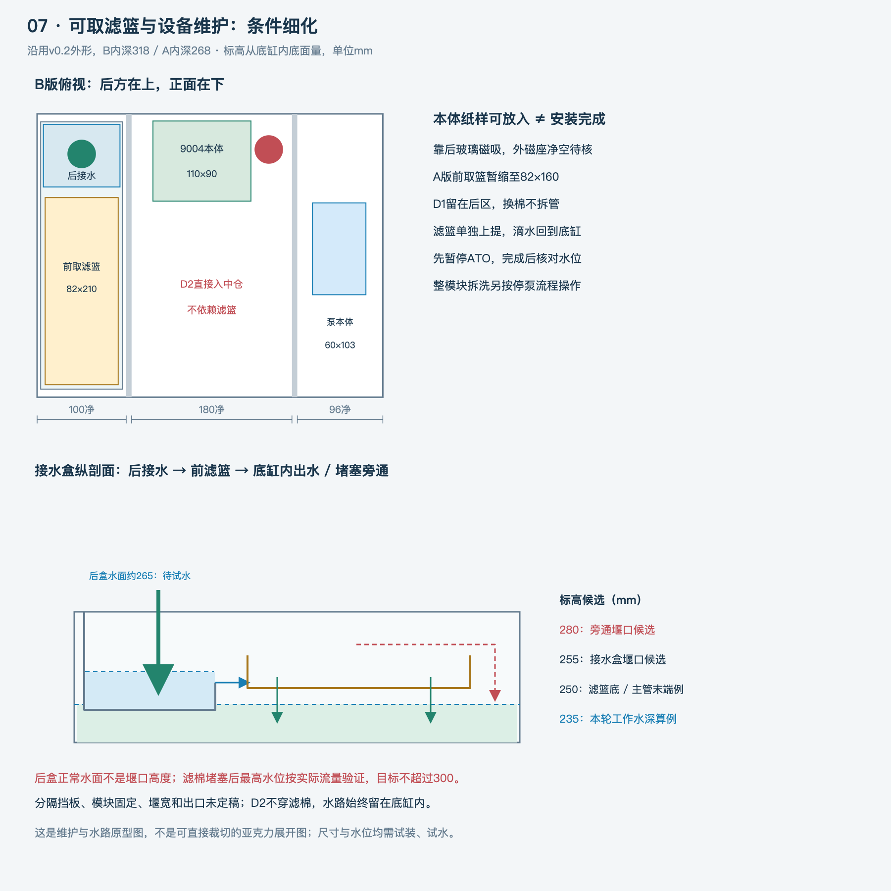

# 继续推进 v0.3：设备、滤篮与容水复核

日期：2026-10-19。本轮延续v0.2，用户已授权继续；未改变其尺寸偏好或代为下单。主缸/架体候选外形保持，新增的是设备空间与水路细化，不是已冻结的第三套加工规格。

## 这次真正推进的部分

1. 回水增加SICCE Syncra Silent 1.5的原厂参数候选，区分本体、包装和接管空间，不再只有一个“蓝白系列”名称。
2. 底缸过滤细化为**后接水、前取篮、堵塞时在底缸内旁通**；换棉不拆主下水，D2直接进入中仓。
3. 把模块额外存水及设备占容加入初筛，做18组水位/降水量敏感性计算。此前空几何余量不足以说明适用。
4. 发现450高底缸在800架下，约244头部净空小于9004整机305高度。日常取杯与整机取出分开核验，不能再把“放得下”等于“方便维护”。
5. 补齐主缸高水位、漏水和ATO各自的动作要求，避免把补水器的防溢探头误当全系统保护。

## 新图

- [07 滤篮模块与设备维护](design/07-滤篮与设备维护-v0.3.png)
- [08 容水复核与保护动作](design/08-容水与保护动作-v0.3.png)
- [09 A4本体纸样预览](design/09-设备本体纸样-A4-v0.3.png)，[按实际大小打印的SVG](design/09-设备本体纸样-A4-v0.3.svg)

纸样只对应本体，打印后用100mm校准线检查。PNG是屏幕预览，不拿图片缩放值当实际尺寸。

## 当前判断

仍建议先核验450深B版，400深A版保留优化路线；没有替用户确认最终深度。考虑模块和稍高工作水深后，两版都没有得到安全结论。

本轮235水深、20mm主缸降水、模块储水2L及实体占容2L的示例下，扣完回流、3.3L误补水和额外3L裕量，B余约1.66L、A约-0.94L。B若实际降水30mm也会变负。这些是**未测预算下的敏感性结果**，不证明B已经安全或A一定不可行；需要真实堰口、设备及水位，再调整容水布置。

下一步最值得向商家拿的三样东西：蛋分/泵完整尺寸及装取演示、主缸与底缸同版水位图、接头孔位与铝架台面配合图。预算暂不增加虚构价格，有新机或二手真实报价再回填。

详细记录：[设备空间与回水](research/设备空间与回水核验-v0.3.md)、[滤篮模块](design/滤篮模块与维护-v0.3.md)、[容水复核](design/容水复核-v0.3.md)、[保护动作](docs/保护动作与设备准入-v0.3.md)。
